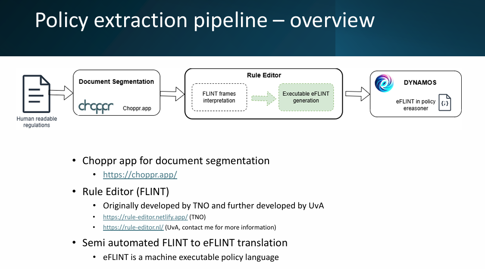
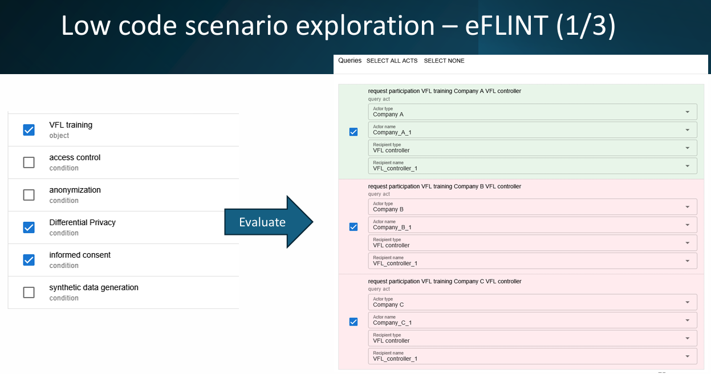
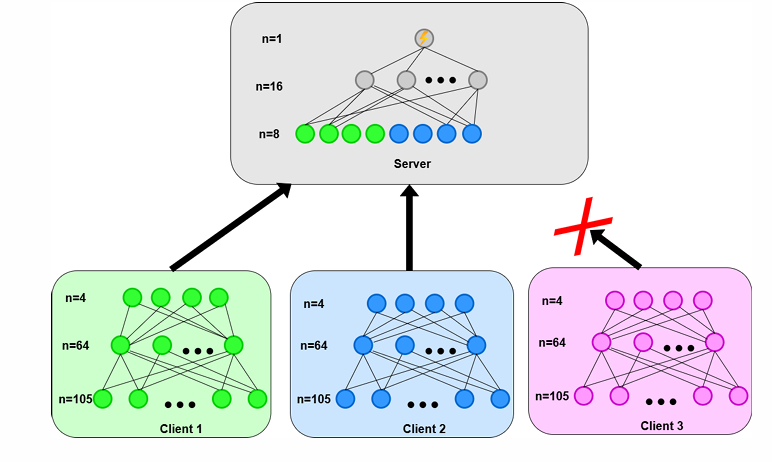

#  eFLINT-based policy extraction pipeline for Federated Learning infrastructure demonstration at [ICT Open 2026](https://ictopen.nl/)

Federated Learning is a family of machine learning (ML)techiniques in which models are trained locally on private datasets rather than by centralizing the data in a single location. Instead of sharing sensitive datasets, participants share only the trained model updates. This approach helps compliance with privacy and soverreignty requirements while still enables the development of effective ML models. 

In this demonstration we showed how our policy-driven distributed Vertical Federated Learning (VFL) infrastructure ([DYNAMOS](https://github.com/DYNAMOS-UVA/Scattered-Directive)) can be integated with a new policy extraction pipeline. Particularly, the pipeline interprets the policies/regulations that are given via natural language text into the machine executable [eFLINT](https://gitlab.com/eflint) code. This process is implemented through the rule-editor application ([repository](https://github.com/MOOI-Project-UvA/rule-editor)) that was originally developed by TNO and further improved by UvA. The generated eFLINT code can then be integrated into the DYNAMOS infrastructure and form the basis for the policy-driven VFL execution. 

_Figure 1: eFLINT-based policy extraction pipeline and integration with DYNAMOS_

_Figure 2: VFL scenario exploration_

_Figure 3: VFL client exclusion based on policy_

Presentation [pdf](./ICT_open_2026_VFL_demo_Koufakis.pdf), [pptx](./ICT_open_2026_VFL_demo_Koufakis_w_vid.pptx)

